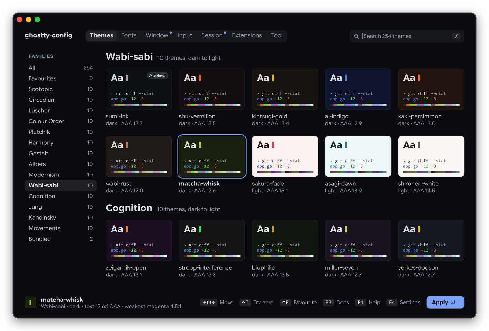
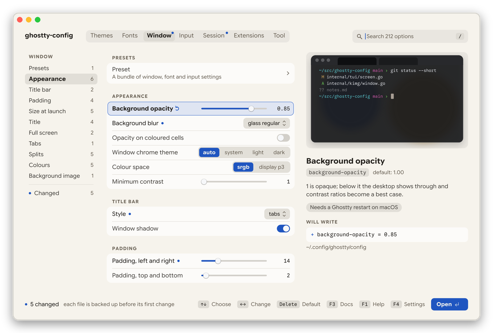
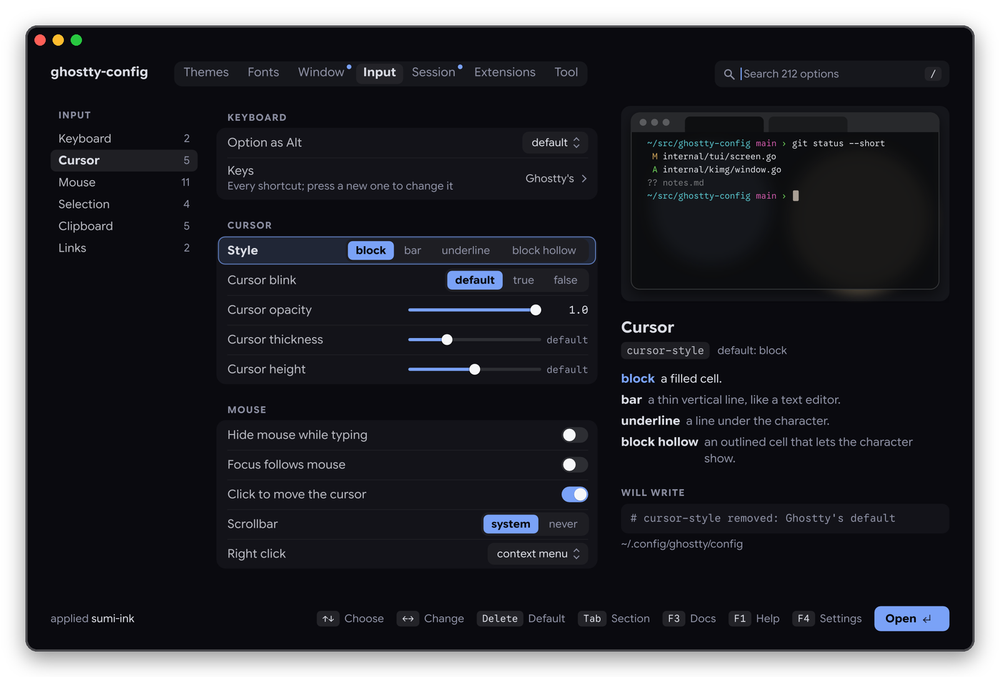
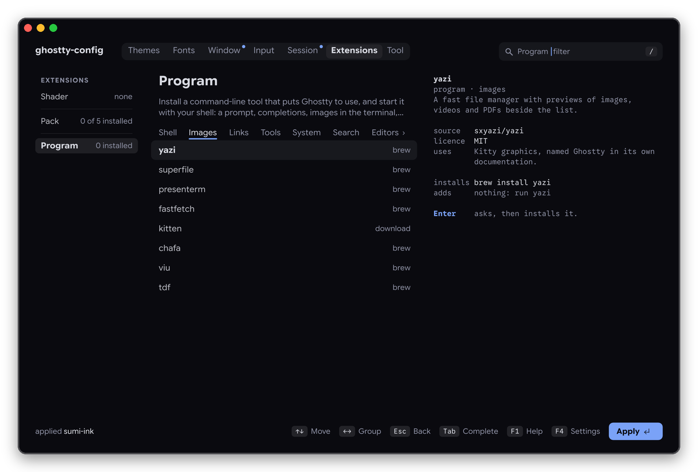
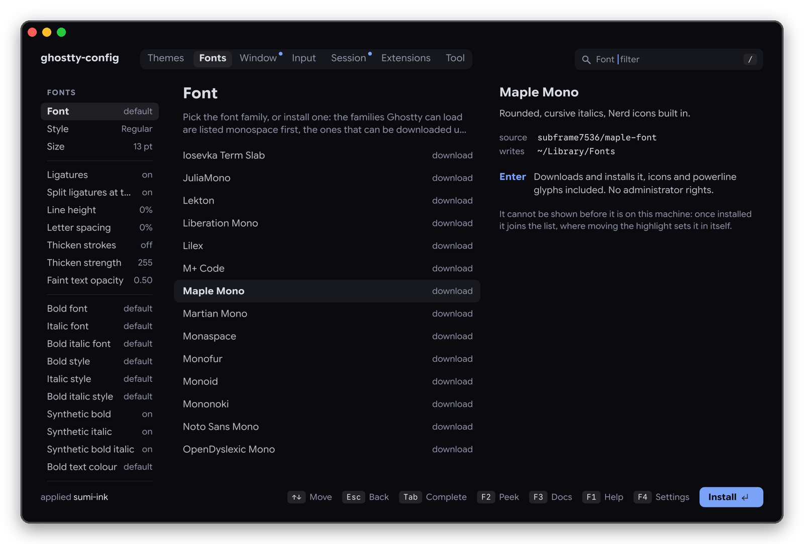
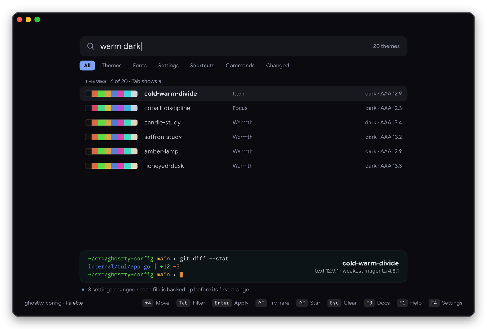
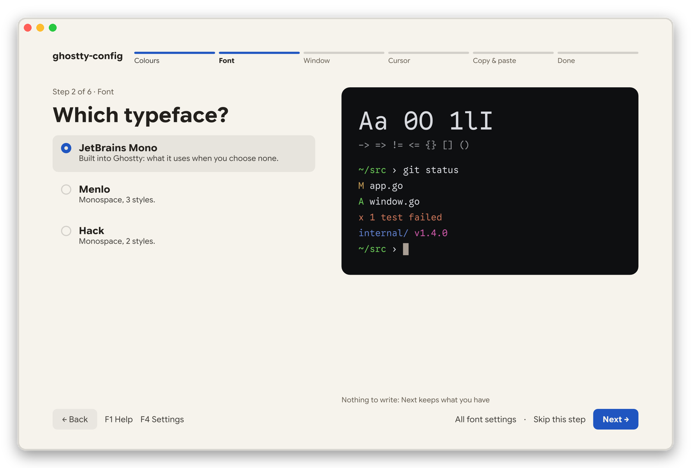

<p align="center"></p>

<h1 align="center">ghostty-config</h1>

<p align="center">Themes, fonts, programs and every setting of <a href="https://ghostty.org">Ghostty</a>, in a full-screen interface inside the terminal.<br>One binary, one command to install. <a href="https://vitruves.github.io/ghostty-config/">Website</a>.</p>

<p align="center">
  <a href="#install"></a>
  <a href="https://github.com/vitruves/ghostty-config/tags"></a>
  
  <a href="LICENSE"></a>
  <a href="https://cli.masoko.net/tools/ghostty-config/"></a>
</p>

<p align="center"></p>

## Install

```bash
curl -fsSL https://ghostty-config.vitruves.workers.dev/install.sh | sh
```

or `pip install ghostty-config` (pipx and uv work too). Then run `ghostty-config`. On Termux the same command installs the Android build; where a release has none, it builds from source, which needs Go and git: `pkg install git golang`. Browsing changes nothing: a theme or a font is written when you press `Enter`, a setting when you change its value.

<details>
<summary><b>From source</b></summary>

Needs Go 1.26 or later.

```bash
git clone https://github.com/vitruves/ghostty-config.git
cd ghostty-config
make build           # builds build/ghostty-config
make local-install   # copies it to ~/.local/bin, no sudo
```

`make install` puts it in `/usr/local/bin` instead (asks for sudo). Or, with Go alone: `go install github.com/vitruves/ghostty-config/cmd/ghostty-config@latest`.

</details>

## Everything in one place

<table>
<tr>
<td width="50%" valign="top"><br><b>212 settings</b>, grouped in cards with a live preview, every value explained, and the exact line that will be written.</td>
<td width="50%" valign="top"><br><b>Cursor, mouse, clipboard, shortcuts:</b> press a new shortcut, conflicts are shown. Light or dark, any accent colour.</td>
</tr>
</table>

## Download from inside, in one Enter

| | |
| :--- | :--- |
| **1071 themes** | the 252 of the curated collection in 27 families, the 819 Ghostty ships, and 5 packs (cyberdream, onedarkpro, nightfly, vscode, oasis) |
| **70 fonts** | the whole Nerd Fonts release, Google Sans Code, Maple Mono, JuliaMono, installed without admin rights |
| **37 programs** | zellij, yazi, starship, zoxide, fzf, atuin, lazygit, btop, neovim, helix… started with your shell |
| **16 shaders** | cursor trails (smear, blaze, warp, sweep…) and screen effects (bloom, CRT, VHS, starfield, black hole) |

<table>
<tr>
<td width="50%" valign="top"><br><b>Programs</b> that put Ghostty to use: prompts and completions, images in the terminal (Kitty graphics), clickable links (OSC 8), system monitors, editors, sessions.</td>
<td width="50%" valign="top"><br><b>Fonts</b> you have, then the ones to download, with the Nerd Font icons included. The specimen is set in the font itself.</td>
</tr>
</table>

<details>
<summary><b>The 37 programs, and how they are installed</b></summary>

- **Shell:** starship, zoxide, fzf, atuin, carapace, lig
- **Images:** yazi, superfile, presenterm, fastfetch, kitten icat, chafa, viu, tdf (PDFs)
- **Links:** ripgrep, eza, fd, delta
- **Tools:** bat, glow, lazygit
- **System:** btop, bottom, dust, duf, procs, hyperfine
- **Search:** television, jq, fx, tealdeer, navi
- **Editors:** neovim, helix, micro
- **Sessions:** zmx, zellij

From Homebrew when you have it, else from the project's GitHub release into `~/.local/bin`, checked against the SHA-256 GitHub gives; never as root. The line that starts it goes in one marked block of `~/.zshrc`, `~/.bashrc` (`~/.bash_profile` on macOS) or `conf.d/ghostty-config.fish`, backed up before its first change. Switching a program off takes its line out; `Ctrl+X` uninstalls it after a yes. A line of your own, or a program installed some other way (apt, cargo…), is left alone.

</details>

## Three layouts

<table>
<tr>
<td width="50%" valign="top"><br><b>Palette:</b> one search line over themes, fonts, settings, shortcuts and commands.</td>
<td width="50%" valign="top"><br><b>Guided:</b> six plain questions, one page at a time, with large previews.</td>
</tr>
</table>

**Atelier**, the sections and the wall of themes above, is the third. A chooser asks at first launch; switch any time with `F4`.

<details>
<summary><b>Keys</b></summary>

| Key | Action |
| :---: | :--- |
| `Tab` | Next section |
| `↑` `↓` | Move through the list |
| `←` `→` | Change the highlighted setting |
| `Enter` | Apply, or open the full list of values |
| `Delete` | Back to Ghostty's default |
| `Ctrl+Z` | Undo the last change |
| `/` or type | Search themes, settings and commands |
| `Ctrl+T` `Ctrl+F` | Try a theme in this terminal; star it |
| `F3` | Ghostty's own documentation of the highlighted line (Ghostty 1.4) |
| `F4` | ghostty-config's own settings: layout, look, reload, update check, drawing |
| `F1` `Esc` | Help; go back, then quit |

Everything can be clicked too: sections, pills, switches, the menu of a long value, and a double click on a theme card applies it. Sliders are pulled: the preview follows the pointer and the value is written when you let go. Palette and Guided show their keys in the footer.

</details>

<details>
<summary><b>Good to know</b></summary>

- **Your files.** Each setting is rewritten on its own line and comments are kept. Every file is backed up to `~/.config/ghostty-config/backups/` before its first change.
- **Checked.** After each write the config goes through `ghostty +validate-config`, and any problem is shown with its line.
- **Reload.** On macOS with Ghostty 1.3 or later the tool asks Ghostty to reload over AppleScript (macOS asks once, under Privacy & Security → Automation); older versions get the reload shortcut (needs the Accessibility permission). On Linux it activates `reload-config` over D-Bus (needs `gdbus` and a single-instance Ghostty).
- **Ghostty 1.3 and 1.4.** Settings follow the Ghostty you have: 1.4's new ones (scrollback in bytes, clipboard access and limits, `link-osc8`, the SSH terminfo cache…) are offered to 1.4. The few options that are lists of lines (`env`, `key-remap`…) stay in the file.
- **Display.** In Ghostty and Kitty the interface is drawn as images (Kitty graphics protocol), elsewhere and in tmux with plain text.
- **Network.** At most once an hour, a background check on GitHub offers new releases. Nothing else uses the network except downloads you ask for.
- **The install script** puts a checksum-verified binary in `~/.local/bin`, for macOS or Linux, Intel or ARM. No Go, no git, no dependencies.

</details>

<details>
<summary><b>Options</b></summary>

```
-config file            edit this file instead of the default config
-themes dir             user themes directory
-cells                  draw the interface with terminal text, keeping images for theme cards
-no-images              never draw images
-images                 draw images even where the terminal is not known to support them
-plain                  use only characters every terminal can draw
-no-reload              never ask Ghostty to reload
-no-update-check        never check GitHub for a new release
-export-collection dir  write the curated themes to a directory and exit
-paths                  print the files that are read and written
-version                print the version
```

The display and reload flags hold for one launch; `F4` keeps a choice for every launch, and a flag overrides it.

</details>

See [CHANGELOG.md](CHANGELOG.md) for what changed in each version.

## Credits

[Ghostty](https://github.com/ghostty-org/ghostty) is by Mitchell Hashimoto and its contributors. Shaders come from [KroneCorylus/ghostty-shader-playground](https://github.com/KroneCorylus/ghostty-shader-playground), [hackrdotsh/ghostty-shaders](https://github.com/hackrdotsh/ghostty-shaders), [sahaj-b/cursor-shaders](https://github.com/sahaj-b/cursor-shaders), [hced/ghostty-cursor-trails](https://github.com/hced/ghostty-cursor-trails) and [s0xDk/ghostty-blackhole](https://github.com/s0xDk/ghostty-blackhole); fonts, programs and theme packs from the projects named in the interface. The interface is set in Google Sans Flex and Google Sans Code (SIL OFL). MIT licence.
