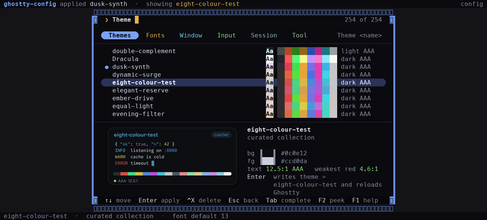
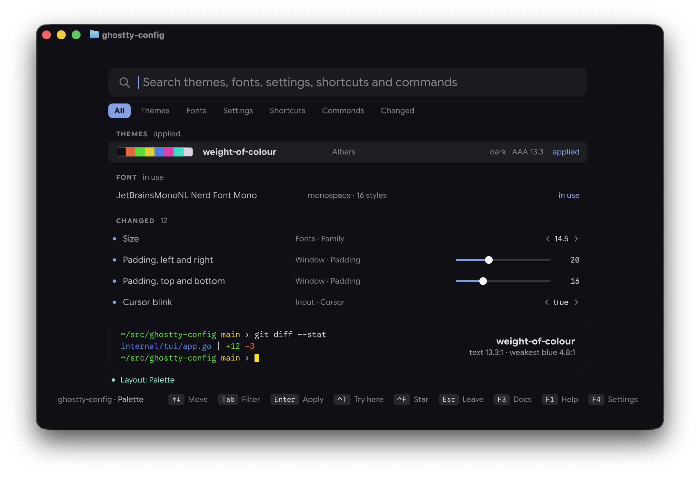
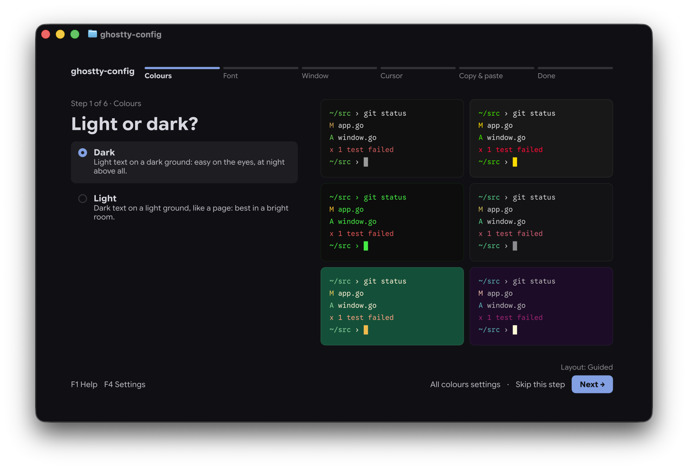
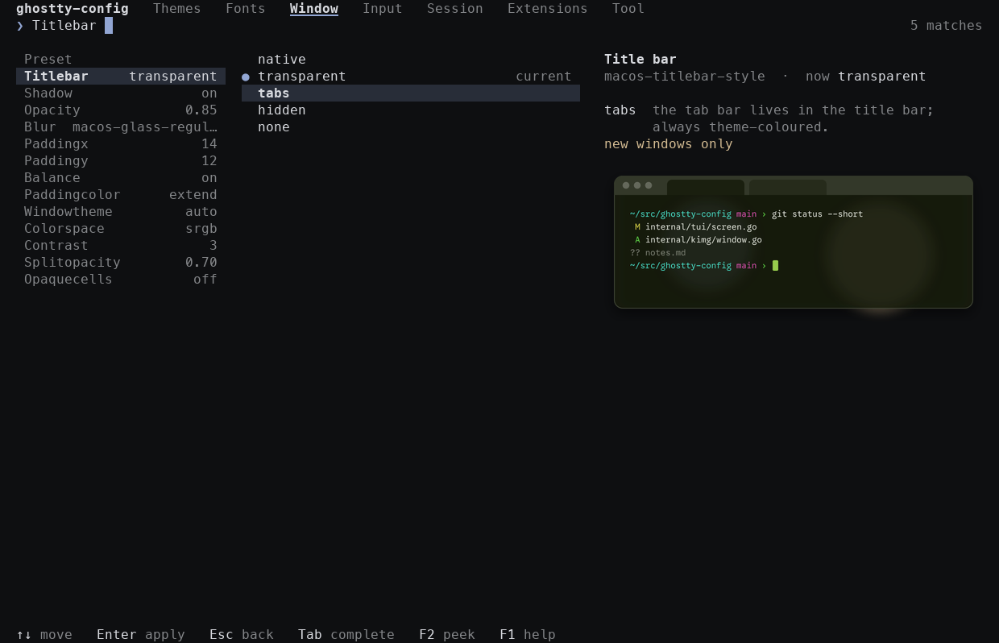

<p align="center"></p>

<h1 align="center">ghostty-config</h1>

<p align="center">Themes, fonts, shortcuts and every everyday setting of <a href="https://ghostty.org">Ghostty</a>, in a full-screen interface inside the terminal.<br>A single binary, installed with one command.</p>

<p align="center">
  <a href="#install"></a>
  <a href="https://github.com/vitruves/ghostty-config/tags"></a>
  
  <a href="LICENSE"></a>
  <a href="https://cli.masoko.net/tools/ghostty-config/"></a>
</p>

<p align="center">
  
</p>

## Install

```bash
curl -fsSL https://ghostty-config.vitruves.workers.dev/install.sh | sh
```

The script puts a checksum-verified binary for your system (macOS or Linux, Intel or ARM) in `~/.local/bin`. No Go, no git, no dependencies. From source: `git clone https://github.com/vitruves/ghostty-config.git && cd ghostty-config && make build && make local-install`.

## Use

Run `ghostty-config`. Browsing changes nothing: a theme or a font is written when you press `Enter` on it, a setting when you change its value.

## Layouts

The same settings, three ways to reach them. A chooser asks for one at first launch; switch any time with `F4` or in Tool → Interface → Layout.

- **Atelier:** sections in a sidebar, the wall of themes, every setting in its place (the screenshots above and below).
- **Palette:** one search line over themes, fonts, settings, shortcuts and commands, with filters. The highlighted setting opens in place; a theme previews in a strip drawn in its colours.
- **Guided:** six plain questions, one page at a time (Colours, Font, Window, Cursor, Copy & paste, Done), with large previews and a link to all the settings of each step.

<p align="center">
  
</p>

<p align="center">
  
</p>

## Keys

The keys of Atelier; Palette and Guided show theirs in the footer.

<div align="center">

| Key | Action |
| :---: | :--- |
| `Tab` | Next section |
| `↑` `↓` | Move through the list |
| `←` `→` | Change the highlighted setting |
| `Enter` | Apply, or open the full list of values |
| `Delete` | Back to Ghostty's default |
| `Ctrl+Z` | Undo the last change |
| `/` or type | Search themes, settings and commands |
| `Ctrl+T` `Ctrl+F` | Try a theme in this terminal; star it |
| `F3` | Ghostty's own documentation of the highlighted line (Ghostty 1.4) |
| `F4` | ghostty-config's own settings: layout, look, reload, update check, drawing |
| `F1` `Esc` | Help; go back, then quit |

</div>

Everything can be clicked too: sections, pills, switches, sliders, and a double click on a theme card applies it.

<p align="center">
  
</p>

## Sections

- **Themes:** 1071 themes, the 252 of the curated collection in 27 families and the 819 Ghostty 1.4 ships, plus your own, each shown as a card and checked for contrast. Create, edit and save your own.
- **Fonts:** family, style and size with a specimen set in the font itself, spacing, ligatures, the OpenType features and variable axes the font really has, Nerd Font icons. 70 monospace families can be downloaded in one Enter, and if your font is missing or proportional the tool offers one.
- **Window:** title bar, opacity, blur, padding, background image, size and position at launch, with a preview.
- **Input:** cursor, clipboard, mouse, and every keyboard shortcut: press the new one, conflicts are shown.
- **Session:** scrollback, window restore, quick terminal, bell, notifications, shell integration.
- **Extensions:** shaders and theme packs, with their source and licence shown before install.
- **Tool:** reload Ghostty, check the config, see the session's changes, restore a backup, the interface's own layout and look: its scheme, accent colour and contrast, and when drawn as images its size and the width of theme cards.

Settings follow the Ghostty you have: 1.4's new ones (scrollback in bytes, clipboard access and limits, `link-osc8`, the SSH terminfo cache…) are offered to 1.4, and 1.3 keeps working. See [CHANGELOG.md](CHANGELOG.md) for what changed in each version.

## Good to know

- **Your files.** Each setting is rewritten on its own line and comments are kept. If a file changed elsewhere meanwhile, your edits there are kept too. Every file is backed up to `~/.config/ghostty-config/backups/` before its first change.
- **Checked.** After each write the config goes through `ghostty +validate-config`, and any problem is shown with its line.
- **Reload.** On macOS with Ghostty 1.3 or later the tool asks Ghostty to reload over AppleScript (macOS asks once, under Privacy & Security → Automation); older versions get the reload shortcut instead (needs the Accessibility permission). On Linux it activates Ghostty's `reload-config` action over D-Bus, which needs `gdbus` and a single-instance Ghostty; otherwise, reload Ghostty yourself.
- **Display.** In Ghostty and Kitty the interface is drawn as images (Kitty graphics protocol), elsewhere and in tmux with plain text.
- **Updates.** At most once an hour, a background check on GitHub offers new releases. Nothing else uses the network except downloads you ask for.

## Options

```
-config file            edit this file instead of the default config
-themes dir             user themes directory
-cells                  draw the interface with terminal text, keeping images for theme cards
-no-images              never draw images
-images                 draw images even where the terminal is not known to support them
-plain                  use only characters every terminal can draw
-no-reload              never ask Ghostty to reload
-no-update-check        never check GitHub for a new release
-export-collection dir  write the curated themes to a directory and exit
-paths                  print the files that are read and written
-version                print the version
```

`-cells`, `-no-images`, `-images`, `-plain`, `-no-reload` and `-no-update-check` hold for one launch. To keep a choice for every launch, set it in `F4` (Drawing, Simple glyphs, Reload Ghostty after each change, Check for updates); a flag given on the command line overrides the saved preference, and `F4` shows that row as set by the flag.

## Credits

[Ghostty](https://github.com/ghostty-org/ghostty) is by Mitchell Hashimoto and its contributors. Shaders come from [KroneCorylus/ghostty-shader-playground](https://github.com/KroneCorylus/ghostty-shader-playground) and [0xhckr/ghostty-shaders](https://github.com/0xhckr/ghostty-shaders). The interface is set in Google Sans Flex and Google Sans Code (SIL OFL). MIT licence.
